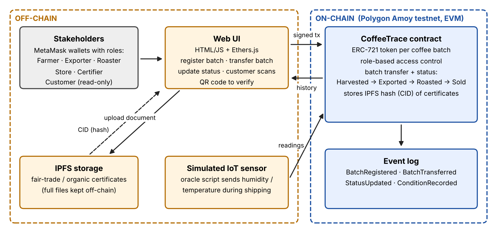

# CoffeeTrace: Blockchain-Based Coffee Supply Chain Provenance

**CSE 540: Engineering Blockchain Applications (Fall B 2026), Team 28**
Abdullah Alshahrani · Maharshi Saragadam · Mohammed Saeed M Alghamdi · Varshini Muniswaran

> **Status: Smart Contract Design Draft (Nov 1, 2026).** The contract structure, interfaces and
> core logic are in place and compile. The web UI, IoT simulator script and automated tests are
> planned for the next milestones (see [Roadmap](#roadmap)).

---

## 1. Project Description

Specialty coffee sells at a premium because of claims about **where and how it was grown**
(single origin, fair trade, organic). Between the farm and the cup, a coffee lot passes through
several independent companies, and none of them controls a shared, trusted record, so origin
fraud is easy and hard to detect.

**CoffeeTrace** records each coffee batch on a public blockchain, so its history cannot be
quietly changed:

```
Farmer  ──►  Exporter  ──►  Roaster  ──►  Retailer (store)  ──►  Customer
Harvested    Exported       Roasted       Sold
```

- Each batch is an **ERC-721 token** with a unique ID and an owner.
- Each stakeholder has a **role**. Only the current owner can move a batch, and only to the
  next stakeholder in the chain.
- **Fair-trade / organic certificates** are stored on **IPFS**; only their hash (CID) is kept
  on-chain, so any change to the file can be detected.
- A **simulated IoT sensor** records temperature and humidity during shipping.
- Each batch stores the farm's **GPS coordinates** (required by the EU Deforestation Regulation).
- Every action emits an **event**, which gives a permanent, public history. Customers can view it
  by scanning a QR code.



---

## 2. Repository Structure

```
.
├── contracts/
│   ├── CoffeeTrace.sol             # main smart contract (ERC-721 + role-based access control)
│   └── interfaces/
│       └── ICoffeeTrace.sol        # interface: data types, events, function signatures
├── docs/
│   └── architecture.png            # system architecture (Fig. 1 of the proposal)
├── frontend/                       # web UI (planned: HTML/JS + Ethers.js + MetaMask)
├── scripts/                        # deploy + simulated IoT oracle scripts (planned)
├── test/                           # automated tests (planned)
├── hardhat.config.js               # optional Hardhat setup
└── package.json
```

---

## 3. Smart Contract Design

### Roles

| Role | Who | Can do |
|---|---|---|
| `DEFAULT_ADMIN_ROLE` | Deployer (team admin) | Grant / revoke all roles below |
| `FARMER_ROLE` | Coffee farm / cooperative | Register new batches |
| `EXPORTER_ROLE` | Exporter | Receive from farmer, mark **Exported** |
| `ROASTER_ROLE` | Roaster | Receive from exporter, mark **Roasted** |
| `RETAILER_ROLE` | Store | Receive from roaster, mark **Sold**, hand over to customer |
| `CERTIFIER_ROLE` | Fair-trade / organic certifier | Certify a batch with an IPFS CID |
| `ORACLE_ROLE` | Simulated IoT sensor | Record temperature / humidity |
| *(none)* | Customer / public | Read any batch (view functions) |

### Functions

| Function | Access | Description |
|---|---|---|
| `registerBatch(origin, geolocation, variety, weightKg, harvestDate)` | Farmer | Creates a batch, mints an ERC-721 token to the farmer |
| `transferBatch(batchId, to)` | Current owner | Hands the batch to the next stakeholder (recipient's role is checked) |
| `updateStatus(batchId, newStatus)` | Current owner with matching role | Moves the batch forward **one** stage |
| `certifyBatch(batchId, certificateCID)` | Certifier | Marks the batch certified and stores the IPFS CID |
| `recordCondition(batchId, temperatureX10, humidityX10)` | Oracle | Stores a sensor reading (e.g. `215` = 21.5 °C) |
| `getBatch(batchId)` | Anyone | Full batch record |
| `getCustodyHistory(batchId)` | Anyone | Every address that has held the batch, in order |
| `getConditionReadings(batchId)` | Anyone | All sensor readings |
| `totalBatches()` | Anyone | Number of registered batches |

### Events

`BatchRegistered` · `BatchTransferred` · `StatusUpdated` · `BatchCertified` · `ConditionRecorded`

### Safety rules enforced by the contract

- Status can only move **forward one step** (it can't skip from Harvested to Roasted or go backwards).
- A batch can only be transferred to an address with the **next role** in the chain.
- Standard ERC-721 `transferFrom` / `safeTransferFrom` are **disabled**, so the role checks can't be bypassed.
- A batch can only be certified **once**; sensor readings are rejected after the batch is **Sold**.
- Custom errors (e.g. `NotBatchOwner`, `InvalidStatusTransition`) explain why a transaction failed.

---

## 4. Dependencies

| Tool | Purpose |
|---|---|
| [Solidity](https://docs.soliditylang.org) `^0.8.24` | Smart contract language |
| [OpenZeppelin Contracts](https://docs.openzeppelin.com/contracts/5.x/) `5.x` | `ERC721`, `AccessControl` |
| [Remix IDE](https://remix.ethereum.org) | Compile and deploy in the browser (main workflow) |
| [MetaMask](https://metamask.io) | One wallet per stakeholder |
| Polygon **Amoy** testnet + free **POL** test tokens | Deployment network |
| Hardhat *(optional)* | Local compile / tests |
| IPFS *(planned)* | Certificate storage |

---

## 5. How to Deploy and Use (Remix + Polygon Amoy)

### A. Set up MetaMask
1. Install MetaMask and create **several accounts** (admin, farmer, exporter, roaster, retailer, certifier, oracle).
2. Add the **Polygon Amoy** network (e.g. through ChainList) and get free **POL** from the Polygon faucet for the admin account.

### B. Compile
1. Open [Remix](https://remix.ethereum.org) and create `CoffeeTrace.sol` and `interfaces/ICoffeeTrace.sol` with the code from `contracts/`.
2. In **Solidity Compiler**, select version **0.8.24 or newer**. Under *Advanced Configurations*, make sure the **EVM version is `cancun`** (or later). OpenZeppelin 5.x requires this.
3. Click **Compile CoffeeTrace.sol**. Remix downloads the OpenZeppelin imports automatically.

> For a quick test without MetaMask, choose **Remix VM (Cancun)** as the environment instead.

### C. Deploy
1. In **Deploy & Run Transactions**, set the environment to **Injected Provider – MetaMask** (Amoy).
2. Select `CoffeeTrace` and click **Deploy**. The deploying account becomes the admin.

### D. Example workflow
```text
# 1) Admin grants roles (copy the role hash from the FARMER_ROLE() getter, etc.)
grantRole(FARMER_ROLE,   <farmer address>)
grantRole(EXPORTER_ROLE, <exporter address>)
grantRole(ROASTER_ROLE,  <roaster address>)
grantRole(RETAILER_ROLE, <retailer address>)
grantRole(CERTIFIER_ROLE,<certifier address>)
grantRole(ORACLE_ROLE,   <oracle address>)

# 2) Farmer registers a batch  -> batchId = 1
registerBatch("Finca El Paraiso, Huila, Colombia", "2.1167,-75.8833", "Arabica", 500, 1761350400)

# 3) Batch moves along the chain (status values: 0 Harvested, 1 Exported, 2 Roasted, 3 Sold)
[farmer]    transferBatch(1, <exporter>)
[exporter]  updateStatus(1, 1)
[oracle]    recordCondition(1, 215, 605)             # 21.5 °C, 60.5 % humidity
[certifier] certifyBatch(1, "bafy...<IPFS CID>")
[exporter]  transferBatch(1, <roaster>)
[roaster]   updateStatus(1, 2)
[roaster]   transferBatch(1, <retailer>)
[retailer]  updateStatus(1, 3)

# 4) Anyone (customer) verifies the batch
getBatch(1) · getCustodyHistory(1) · getConditionReadings(1)
```

### Optional: Hardhat
```bash
npm install
npx hardhat compile
```

---

## 6. Roadmap

| Milestone | Date | Scope |
|---|---|---|
| ✅ Proposal + Team Contract | Oct 25 | System concept and architecture |
| ✅ **Smart Contract Draft** | **Nov 1** | Contract structure, interfaces, core logic, README |
| ⏳ Interim Demo | Nov 15 | Deploy to Amoy, simple web UI, IPFS upload, end-to-end demo |
| ⏳ Final Project | Dec 4 | QR verification page, IoT oracle script, tests, gas analysis, report |

**Stretch goals:** alerts when temperature/humidity go out of range; splitting one batch into
smaller retail bags; certificate revocation.

---

## 7. References

1. W. Entriken, D. Shirley, J. Evans, N. Sachs, *ERC-721: Non-Fungible Token Standard*, EIP-721, 2018.
2. OpenZeppelin Contracts 5.x documentation: ERC721 and AccessControl.
3. J. Benet, *IPFS: Content Addressed, Versioned, P2P File System*, arXiv:1407.3561, 2014.
